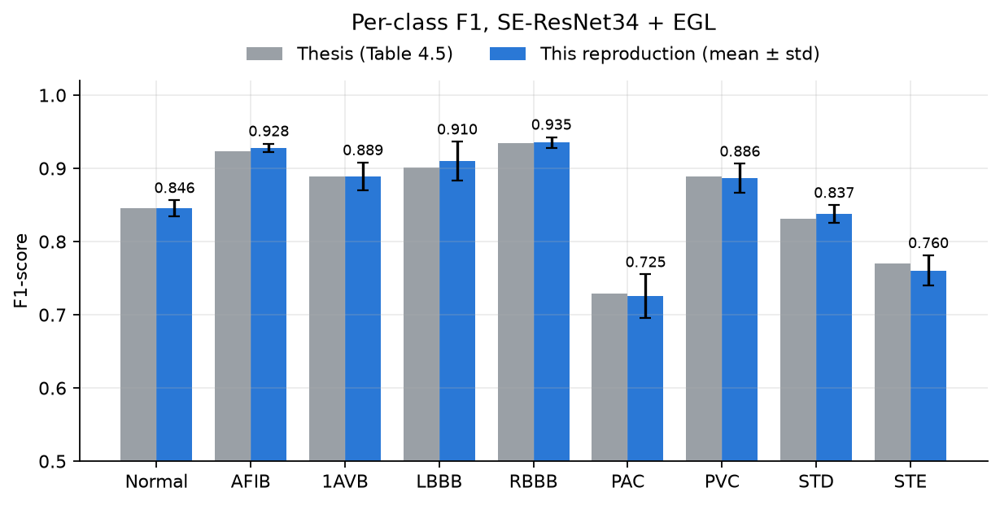
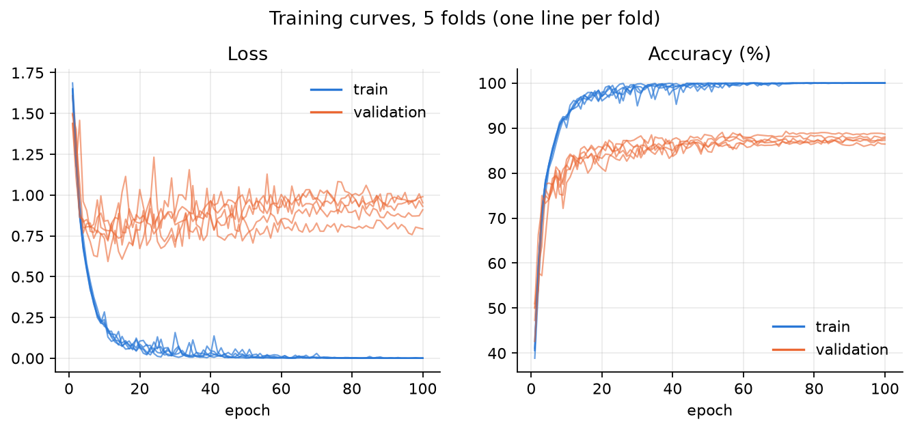
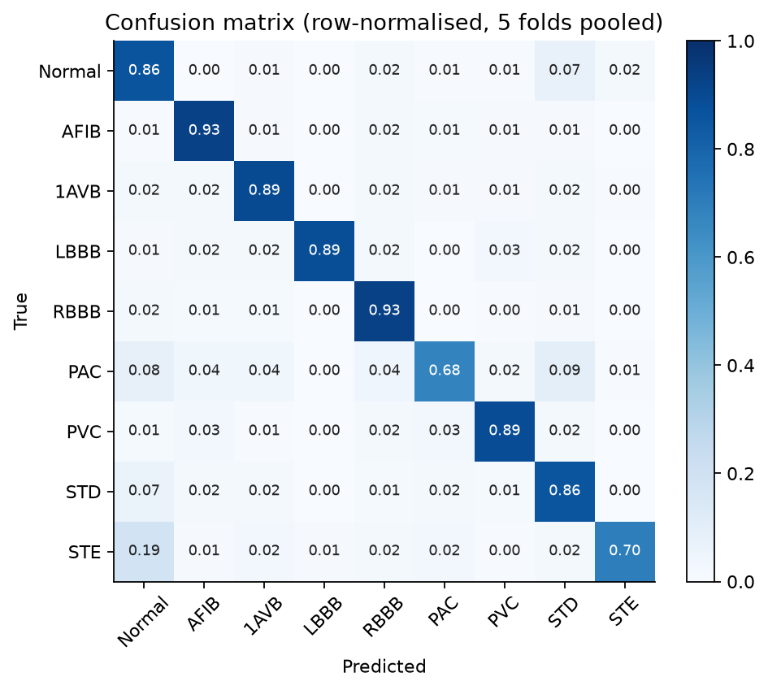
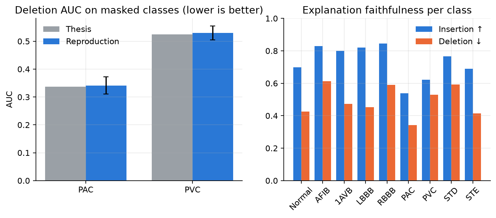

# EAGLe: Explanation-Attention Guided Learning for ECG Arrhythmia Classification


Official implementation of the bachelor thesis **"Explanation-Guided Learning for Cardiac Arrhythmia
Classification"** (*Học có hướng dẫn theo lời giải thích trong bài toán phân loại rối loạn nhịp tim*),
Faculty of Information Technology, University of Science – VNU-HCM, 2025.

Deep models classify ECGs well but often for the wrong reasons. EAGLe injects **clinical expert
knowledge** into training: for a subset of records, a cardiologist-style mask marks *where* the
evidence for the diagnosis lies (e.g. the premature P wave of a PAC, the wide QRS of a PVC). The
model's Class Activation Map (CAM) is pushed to agree with that mask through an extra
explanation loss, improving **both accuracy and the faithfulness of its explanations**.

## Method

```mermaid
flowchart LR
    X["12-lead ECG<br/>(12 × 2500)"] --> F["SE-ResNet34<br/>f&#952;"]
    F --> Y["logits ŷ"] --> LC["L_cls<br/>weighted cross-entropy"]
    F -- "last conv features A" --> CAM["CAM<br/>S(x) = ReLU(Σ w_c,k A_k)"]
    CAM --> SM["soft mask<br/>σ(ω·(S(x) − τ))"]
    M["expert mask m<br/>(PAC / PVC)"] --> LE
    SM --> LE["L_exp = MSE"]
    LC --> L(("L = L_cls + λ·L_exp"))
    LE --> L
```



- **Backbone** – a 1D SE-ResNet34 with an additional squeeze-and-excitation "lead attention" on the
  12 input leads (`eagle/models/seresnet.py`).
- **Explanation** – CAM of the predicted class from the last convolution of `layer4`, upsampled to the
  input length and min–max normalised (`eagle/models/eagle.py`).
- **Explanation loss** – MSE between the soft CAM mask and the expert mask, applied only inside the
  regions annotated by the expert; samples without a mask contribute no explanation loss.
- **Hyper-parameters** – λ = 10, τ = 0.4, ω = 10, AdamW (lr 1e-4, weight decay 1e-4), cosine annealing,
  batch size 64, 100 epochs, 5-fold stratified cross-validation.

## Results

All numbers are macro averages over 5 stratified folds on CPSC 2018 (mean ± std).

**Comparison with re-implemented state-of-the-art methods**

| Model | Precision | Recall | F1-score |
|---|---|---|---|
| CNN-LSTM | 0.7329 ± 0.0100 | 0.7257 ± 0.0102 | 0.7289 ± 0.0102 |
| Inception1D | 0.8094 ± 0.0231 | 0.8053 ± 0.0271 | 0.8066 ± 0.0212 |
| XResNet1D | 0.8094 ± 0.0192 | 0.8072 ± 0.0244 | 0.8077 ± 0.0165 |
| STA-CRNN | 0.8172 ± 0.0378 | 0.8245 ± 0.0371 | 0.8186 ± 0.0197 |
| CRT-Net | 0.8459 ± 0.0126 | 0.8372 ± 0.0111 | 0.8446 ± 0.0112 |
| DCRR-Net | 0.8671 ± 0.0069 | 0.8402 ± 0.0119 | 0.8506 ± 0.0096 |
| SE-ResNet34 (baseline) | 0.8178 ± 0.0092 | 0.8025 ± 0.0065 | 0.8091 ± 0.0075 |
| **SE-ResNet34 + EGL (ours)** | **0.8680 ± 0.0115** | **0.8488 ± 0.0054** | **0.8571 ± 0.0060** |

**Largest per-class gains (F1-score)** – the two classes that received expert masks:

| Class | SE-ResNet34 | + EGL | Δ |
|---|---|---|---|
| PAC | 0.6219 | 0.7288 | +0.1069 |
| PVC | 0.7712 | 0.8894 | +0.1182 |

**Explanation quality** (CAM, Petsiuk et al. 2018)

| Model | PAC Deletion ↓ | PVC Deletion ↓ | Other classes Insertion ↑ |
|---|---|---|---|
| SE-ResNet34 | 0.4423 ± 0.0219 | 0.5292 ± 0.0175 | 0.8182 |
| **SE-ResNet34 + EGL** | **0.3374 ± 0.0216** | **0.5241 ± 0.0095** | **0.8426** |

Backbone selection (ResNet18/34/50, SE-ResNet vs. CBAM-ResNet), full per-class tables and qualitative
saliency maps are in the [thesis](docs/thesis.pdf) (Chapter 4, in Vietnamese).

### Reproduction with this codebase

The model was retrained from scratch with `configs/default.yaml` on the released `CPSC_final.zip`
(5 folds × 100 epochs, Apple M5 GPU, ~2 h in total) and evaluated with `tools/summarize_folds.py`.
The results match the thesis closely:

| Macro average (5 folds) | Precision | Recall | F1-score |
|---|---|---|---|
| Thesis | 0.8680 ± 0.0115 | 0.8488 ± 0.0054 | 0.8571 ± 0.0060 |
| **Reproduction** | **0.8708 ± 0.0087** | **0.8475 ± 0.0082** | **0.8575 ± 0.0075** |

Accuracy is 0.8817 ± 0.0076 and one-vs-rest ROC-AUC 0.9802 ± 0.0025. Deletion AUC is 0.3414 for PAC
(thesis 0.3374) and 0.5297 for PVC (thesis 0.5241). Insertion AUC on the other seven classes is
0.7913 ± 0.0191, lower than the thesis's 0.8426.



| | |
|---|---|
|  |  |



Differences from the thesis run: the released dataset has 12,797 windows and 487 masks (the thesis
reports 13,406 and 450), and training used bfloat16 mixed precision. All numbers, per fold and per
class, are in [`docs/results/metrics.json`](docs/results/metrics.json) and
[`docs/results/per_class.csv`](docs/results/per_class.csv).

## Repository structure

```
├── configs/default.yaml        # all data / training / EGL / evaluation settings
├── data/README.md              # dataset download and expected layout
├── docs/
│   ├── thesis.pdf              # full thesis (Vietnamese)
│   └── results/                # reproduced metrics and figures
├── eagle/
│   ├── data/                   # CPSC2018 dataset, k-fold loaders, signal pre-processing
│   ├── engine/                 # training loop, classification + Deletion/Insertion evaluation
│   └── models/
│       ├── eagle.py            # explanation-guided wrapper (CAM + explanation loss)
│       ├── seresnet.py         # 1D SE-ResNet backbone
│       └── baselines/          # CBAM-ResNet, CNN-LSTM, CRT-Net, DCRR-Net, Inception1D, XResNet1D
├── tools/
│   ├── labelling_app.py        # PyQt5 GUI used to draw the expert masks
│   └── summarize_folds.py      # evaluates every fold, writes docs/results/ (metrics + figures)
├── tests/test_smoke.py         # end-to-end test on synthetic data
├── train.py
└── evaluate.py
```

## Getting started

### 1. Install

```bash
git clone https://github.com/hothephuc/EAGLe_explanation_attention_guided_learning_for_time_series.git
cd EAGLe_explanation_attention_guided_learning_for_time_series
python -m venv .venv && source .venv/bin/activate
pip install -r requirements.txt   # install the CUDA build of PyTorch first if you train on GPU
```

### 2. Data

Download the pre-processed CPSC 2018 windows and expert masks and extract them to `data/CPSC_final/`.
See [data/README.md](data/README.md) for the link, the expected layout and the pre-processing steps.

### 3. Train

```bash
python train.py --config configs/default.yaml
```

For every fold this writes to `results/`: the best checkpoint (`eagle_seresnet_fold{k}.pth`), the
training history and the train/validation split CSVs. To train the plain SE-ResNet baseline, set
`egl.gain_epoch: null` (or `train.use_mask: false`).

Useful flags: `--folds 1` trains only fold 1, and `--epochs 10` overrides the epoch count (handy for a
quick check). `model.device: auto` picks CUDA, then Apple Silicon (MPS), then CPU.

#### Training speed

Three options in `configs/default.yaml` make training about 6× faster without changing the model,
the loss or any hyper-parameter:

| Setting | What it does | Epoch time* |
|---|---|---|
| none (original code) | reads 12,797 `.npz` files from disk every epoch | ~80 s |
| `data.cache: true` | loads every window into RAM once (~1.6 GB, 5 s at start-up) | ~34 s (estimated) |
| `+ train.amp: bf16` | bfloat16 mixed precision on the GPU | 24 s |
| `+ train.compile: true` | `torch.compile` of the backbone (first epoch includes a short warm-up) | **13.5 s** |

\*SE-ResNet34 + EGL, fold 1 (10,251 training windows, batch 64), Apple M5 GPU (MPS), PyTorch 2.14.
One fold of 100 epochs now takes about 23 minutes; all 5 folds about 2 hours.

- **Caching** was the largest win: validation spent 21.5 s reading files versus 2.1 s computing.
  It returns exactly the same tensors as reading from disk (`tests/test_smoke.py::test_cache_matches_disk`).
- **Compilation** keeps checkpoint keys unchanged and the CAM hook working: compiled and eager runs give
  the same loss, CAM within 1e-5 and gradients within 0.02%.
- **Mixed precision** is the only change that can shift results slightly from the thesis (which trained
  in full fp32). Set `train.amp: null` for an exact fp32 reproduction.
- Tried and not worth it on this model: fused AdamW (~3%, within noise) and batch size 128 (no gain
  per sample, and it changes the optimisation).

### 4. Evaluate

```bash
python evaluate.py --config configs/default.yaml
```

Point `eval.checkpoint` / `eval.meta_data_path` at the fold you want. The script prints the
classification report, per-class accuracy and ROC-AUC, saves the confusion matrix next to the
checkpoint and, with `eval.eval_cam: true`, reports overall and per-class Deletion / Insertion AUC.

To evaluate all folds at once and regenerate the metrics and figures in `docs/results/`:

```bash
python tools/summarize_folds.py --config configs/default.yaml
```

### 5. Annotate new expert masks (optional)

```bash
pip install PyQt5
python tools/labelling_app.py --data-dir data/CPSC_final
```

Pick a class and a record, drag the sliders over the relevant region and save; the mask is written to
`data/CPSC_final/mask/<record>_mask.npz` and picked up automatically by `train.py`.

### Tests

```bash
pip install pytest
pytest tests
```

## Authors

- **Nguyễn Bảo Tuấn**
- **Hồ Thế Phúc**

Supervised by **Prof. Dr. Lê Hoài Bắc** and **MSc. Nguyễn Ngọc Đức**, University of Science – VNU-HCM.

## Citation

```bibtex
@thesis{nguyen2025eagle,
  title  = {Explanation-Guided Learning for Cardiac Arrhythmia Classification},
  author = {Nguyễn, Bảo Tuấn and Hồ, Thế Phúc},
  school = {University of Science, Vietnam National University Ho Chi Minh City},
  type   = {Bachelor's thesis},
  year   = {2025}
}
```

## Acknowledgements

- [CPSC 2018](http://2018.icbeb.org/Challenge.html) for the 12-lead ECG dataset.
- Petsiuk et al., *RISE: Randomized Input Sampling for Explanation of Black-box Models* (BMVC 2018),
  for the Deletion / Insertion metrics.
